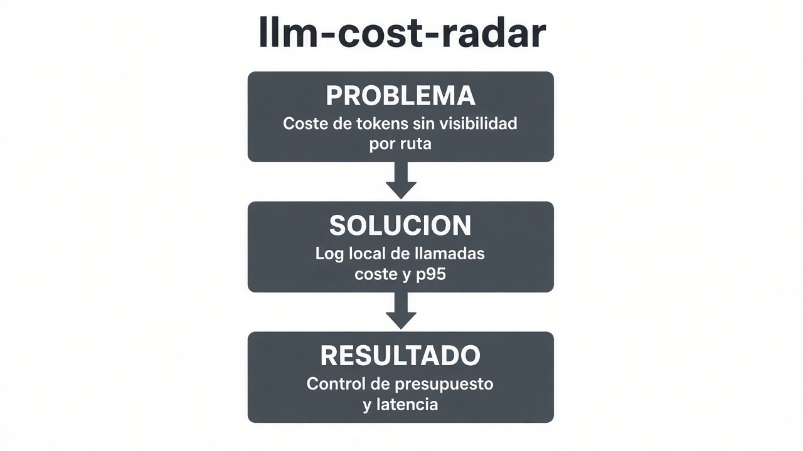
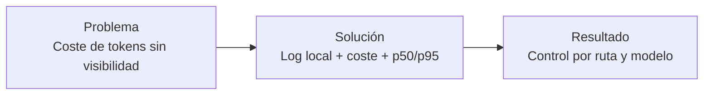

<div align="center">

# llm-cost-radar

**Coste y latencia LLM en local** · Angel Salazar

<br/>


</div>

---

### `$ cat diagrama.md`



---

### `$ cat problema.md`

En producción el presupuesto se va en tokens y nadie lo ve por ruta/modelo.  
Este lab registra llamadas, estima coste y muestra p50/p95.

---

### `$ make local`

```bash
python -m venv .venv
.venv\Scripts\activate
pip install -e .
pytest
python -m cost_radar simulate --model sonnet --n 5
python -m cost_radar summary
python -m cost_radar serve
```

UI: http://127.0.0.1:8010 (Bootstrap simple)

---

Hecho en Lima · Angel Salazar · CIP 404730
